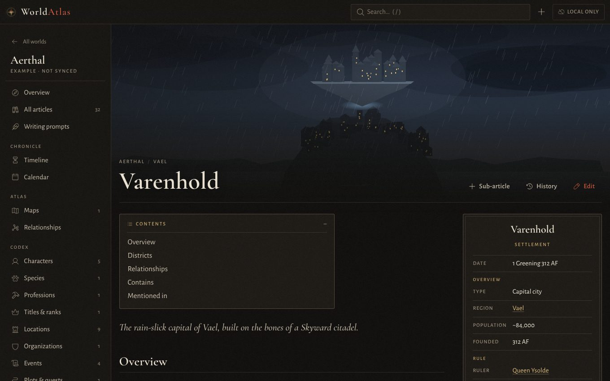
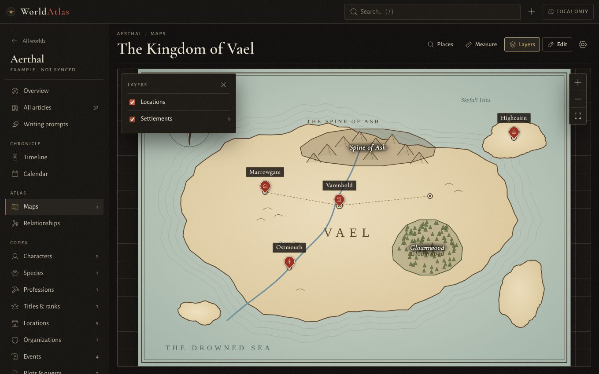
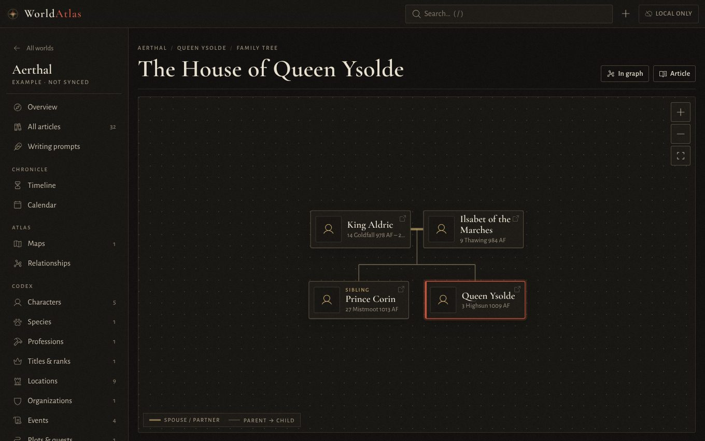
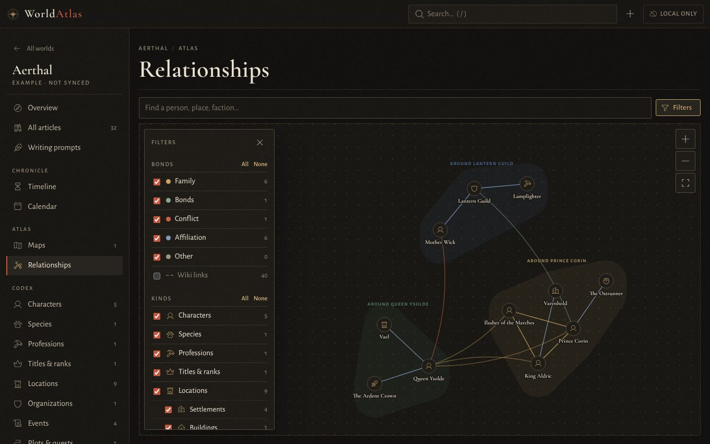

# WorldAtlas

**A worldbuilding wiki for your campaigns and stories, across your phone, tablet and PC: free, and completely private.**
Write about your world's people, places and history, link it all together and pin it on your maps. There's no account, no paid tier and nothing is ever made public. Your world lives on your own devices and your own cloud storage, where nobody else can see it.

**[Open WorldAtlas →](https://momijisu.github.io/WorldAtlas/)** It opens with an example world, Aerthal, to explore.



## Features

**Write**
- Articles from 25 templates (characters, settlements, organisations, spells, conflicts, plots and more), each with an infobox, a portrait and a header image
- An editor that shows Markdown formatted as you type
- Callouts for notes, tips and warnings, and GM notes that stay folded away while you read
- A writing guide for each template and 353 writing prompts, some about your own articles
- Handwritten passages, and your own fonts for runes and invented alphabets

**Connect**
- `[[Links]]` between articles, with suggestions as you type, previews on hover and backlinks, which update when you rename an article
- Other names for an article ("The Iron Queen"), so links to any of them land in the right place
- Excerpts: show part of one article inside another, kept up to date
- Relationships between articles, drawn as a relationship web, family trees and organisation charts
- A tidy-up page that finds duplicate articles and merges them
- Tables in any article that readers can sort, search and roll on: random encounters, price lists, rosters, checklists

**Map**
- Maps with pins, regions, layers and maps nested inside maps
- Numbered pins with a map key you can arrange into groups, in several marker styles
- Distances and travel times on foot, on horseback or by ship, and a scale bar

**Keep track of time**
- Your own calendars with eras and moons, a calendar view and a timeline

**Keep your work safe**
- Version history for every article, and recovery of deleted ones
- Optional sync between your devices through your own OneDrive
- Import from a simple format (handy for turning existing notes into a world with an AI assistant) and full backups to a single file

| | | |
|---|---|---|
|  |  |  |

## Getting started

**Just open it: [momijisu.github.io/WorldAtlas](https://momijisu.github.io/WorldAtlas/).** That's the whole setup.

- **Private by design.** Everything you write is saved on your device, in your browser. WorldAtlas has no server and no database of its own, so nobody (not the developer, not GitHub, not anyone else) can read your work. GitHub only serves the app's files, like any website; it never sees what you write.
- **All your devices, still private.** Connect your own OneDrive and your worlds stay in step on your phone, tablet and PCs: start on one, pick up on another. They're kept in a private folder in *your* OneDrive (`Apps/WorldAtlas`), the only place the app can reach. Your world never leaves your own devices and your own storage. [More about sync](#syncing-between-devices).
- **Or move it by hand.** Prefer not to use OneDrive? Back up to a single file (articles, maps, pictures and history) and restore it on another device. Restoring merges it in: whatever is newer on either side is kept, and an article changed in both places goes to the merge manager.
- **Nothing lost to a clash.** If the same article was changed on two devices before they synced (or before you restored a backup), both versions are kept and the merge manager shows them side by side, so you choose what to keep, part by part.
- **Free, with nothing held back.** No sign-up, no paid plan, no limits, and your worlds are never made public as the price of using it.
- **Always up to date.** New features and fixes arrive by themselves; the app picks them up the next time you open it.
- **Works offline.** Install it from your browser and it opens in its own window, with or without internet. Anything you write offline syncs when you're back online.
  - **Windows, Mac, Linux:** the install icon in the address bar (Chrome or Edge)
  - **Android:** browser menu → *Install app* (Chrome) or *Add to phone* (Edge)
  - **iPhone / iPad:** Share → *Add to Home Screen*

### Prefer to run your own copy?

You don't need to, but you can. WorldAtlas is plain HTML, CSS and JavaScript: no server code and nothing to build.

**On your computer:** download it and serve the folder with any small web server, then open http://localhost:8000:

```sh
git clone https://github.com/Momijisu/WorldAtlas.git
cd WorldAtlas
python3 -m http.server 8000
```

(`npx serve` or VS Code's Live Server work too. Double-clicking `index.html` doesn't, because browsers block web apps loaded straight from files on disk.)

**On your own website:** put the folder on any static host with HTTPS: GitHub Pages, Netlify, Cloudflare Pages or your own server. On GitHub, fork this repository and set **Settings → Pages → Source** to **GitHub Actions**; every push to `main` then publishes it.

A copy of your own only updates when you pull in new versions.

## Syncing between devices

Go to **Settings → OneDrive sync** and choose **Connect OneDrive** on each device, with the same Microsoft account.

- **Only its own folder.** WorldAtlas can only reach `OneDrive/Apps/WorldAtlas`, nothing else in your OneDrive. Each world gets its own folder there; to share a world with a co-writer, share that folder from OneDrive.
- **When it syncs:** shortly after each edit, when the app opens or comes back online, and every couple of minutes. Edits to different articles merge on their own; the same article changed in two places goes to the merge manager.
- **Self-hosting:** this works straight away on the online version. A copy you run or host yourself needs a free one-time registration with Microsoft first: see [docs/SYNC.md](docs/SYNC.md).

## Your data

- **Yours alone.** Your worlds live in your browser on each device, and in your own OneDrive if you turn sync on. There's no account, no tracking, and no copy anywhere else.
- **Take it with you any time:** export a world, or back everything up to a single file, from Settings.
- **Keep a backup.** Browsers can clear a website's data (for example if you clear your browsing data), so without sync, make a backup now and then.

## Roadmap

Ideas being considered, not promises:

- **More places to sync:** Google Drive, and other file shares (such as Dropbox or a shared network folder), so you can keep devices in step with whatever storage you already use
- **Player view:** a read-only copy of a world for your players, with GM notes and secrets left out

## More

- [What's new](CHANGELOG.md): the latest changes, release by release
- [Tables](docs/TABLES.md): adding tables to articles, dice, checkboxes and rolling
- [Import format](docs/IMPORT_FORMAT.md): bring an existing world in, or have an AI assistant convert your notes
- [Syncing in detail](docs/SYNC.md): setting up OneDrive for your own copy, and how syncing works
- [Development](docs/DEVELOPMENT.md): project layout, tests and releasing

## License

WorldAtlas is released under the [MIT License](LICENSE): you're free to use, copy, change and host it. The bundled fonts, icons and libraries keep their own licenses (below).

## Credits

Fonts: Cormorant Garamond, Alegreya, Alegreya Sans, Cedarville Cursive and Kalam, under the SIL Open Font License. Icons: [Phosphor](https://phosphoricons.com) (MIT). Libraries: [marked](https://marked.js.org), [DOMPurify](https://github.com/cure53/DOMPurify) and [CodeMirror](https://codemirror.net).
